# Balatro Mod Updater

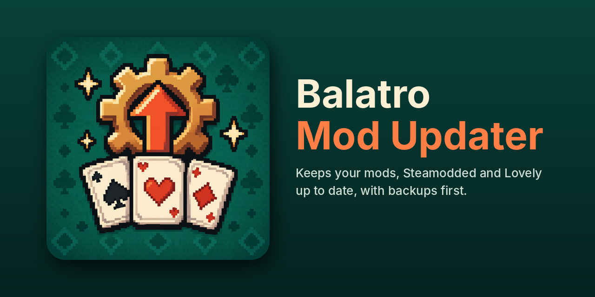

Keeps your Balatro mods, **Steamodded** and **Lovely Injector** up to date, backs everything up before it changes anything, and rescues you when an update breaks the game.

> **Windows only.** Needs Windows PowerShell 5.1, [Steamodded](https://github.com/Steamopollys/Steamodded) 1.x and Lovely.

**Also on Nexus Mods:** [nexusmods.com/balatro/mods/1002](https://www.nexusmods.com/balatro/mods/1002). Download it there or from the [GitHub releases](https://github.com/SilvertongueRED/Balatro-Mod-Updater/releases).

## Contents
- [Features](#features)
- [Installation](#installation)
- [How each mod is updated](#how-each-mod-is-updated)
- [In-game tabs](#in-game-tabs)
- [Fork Finder and the GitHub token](#fork-finder-and-the-github-token)
- [Saved copies of the game](#saved-copies-of-the-game)
- [If the game won't start after an update](#if-the-game-wont-start-after-an-update)
- [Settings](#settings-autoupdater_configjson)
- [Troubleshooting](#known-limits-and-troubleshooting)
- [Changelog](#changelog)
- [More from SilvertongueRED](#more-from-silvertonguered)

## Features

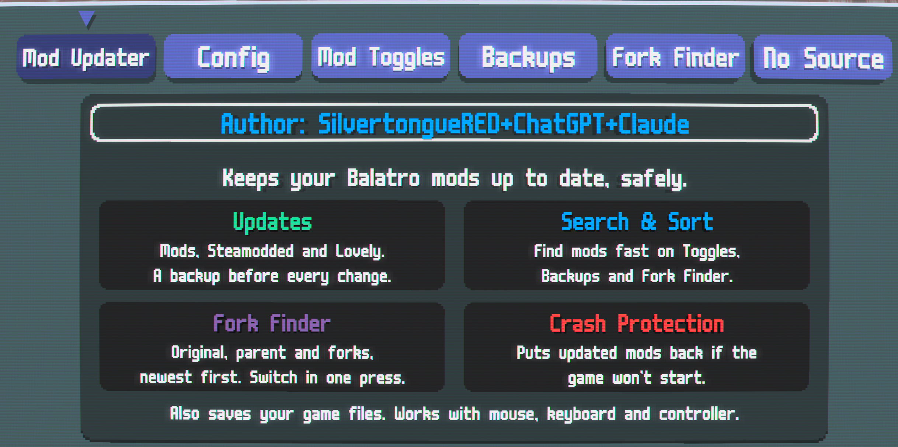

| | |
|---|---|
| **Updates from anywhere** | Mods installed from a **Git** page, **GitHub Releases** or **Nexus Mods**, plus Steamodded and Lovely. Always jumps straight to the newest version. |
| **Backups first** | Every mod and framework is backed up before it is updated. Restore or **pin** any backup, or delete old ones to the Recycle Bin, from the Backups tab. |
| **Crash protection** | If an update crashes the game, a recovery screen offers to put the updated mods back. |
| **Fork Finder** | Finds forks of your mods that have newer work and lets you switch to one (and back). |
| **Saved game copies** | Saves Balatro's game files and switches back to the old version when a Steam update would break your mods. |
| **Search, sort, filter** | Every list tab has live search, sort, show filters and first/last page buttons, with full controller support. |
| **Restart now or later** | After updates you pick **Restart now** or **Later**. |

Auto-checking at startup is **off by default**. Turn it on in the mod's Config tab. While a check runs, the main menu shows **Shuffling mods...**:


When it finds updates it installs them and asks **Restart now** or **Later**. When everything is current a small pop-up says so in the bottom right corner:

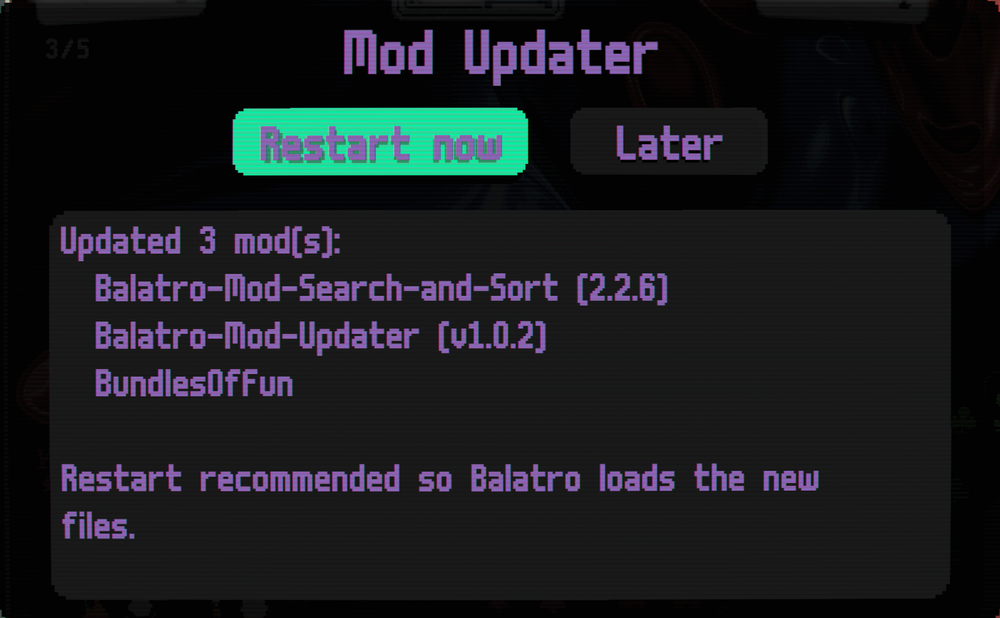

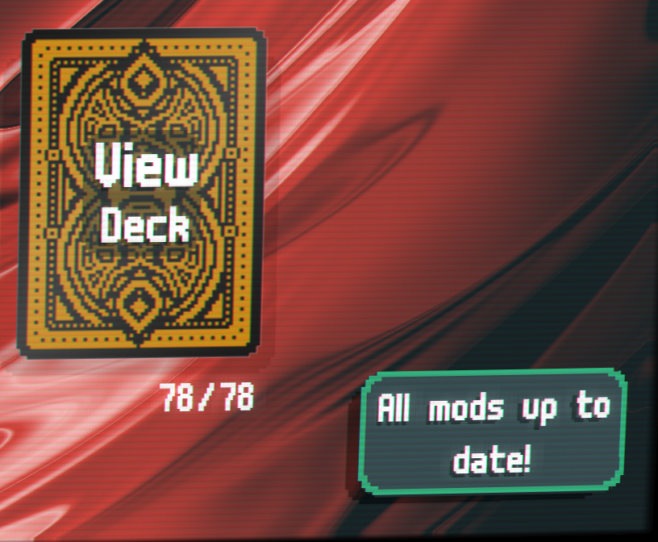

## Installation

1. Install Steamodded and Lovely.
2. Download the zip from [Nexus Mods](https://www.nexusmods.com/balatro/mods/1002) or the [GitHub releases](https://github.com/SilvertongueRED/Balatro-Mod-Updater/releases) and put the `Balatro-Mod-Updater` folder in your Balatro `Mods` folder.
3. Start Balatro and open **Mods > Mod Updater**.
4. Optional: add your Nexus API key (**Config > How do I get a key?**) and turn on **Auto-check at startup**.

## How each mod is updated

| Mod folder has... | What happens |
|---|---|
| `update.json` with `"provider": "github"` or `"nexus"` | That source is used, even if the folder is also a git clone. |
| A git clone | `git pull`. An `update.json` with `"branch": "stable"` switches to and follows that branch. |
| Neither | Never checked. Listed under `untracked_mods` in `last_run.json`. |

### GitHub (`update.json`)
```json
{ "provider": "github", "repo": "Owner/Repo", "track": "auto" }
```

| Option | Meaning |
|---|---|
| `track` | `auto` (default): releases if the repo has any, otherwise the newest commit on the default branch. `release`: releases only. `branch`: always the newest commit (add `"branch": "name"` to pick the branch). |
| `include_prereleases` | `true` also accepts pre-releases. |
| `asset_regex` | Picks the release file. If nothing matches, the source-code zip is used. |
| `strip_single_top_folder` | `true` (default) unpacks a zip with one top folder straight into the mod folder. |

### Nexus (`update.json`)
```json
{ "provider": "nexus", "mod_id": 12345 }
```
- Only **MAIN** files are used and the newest upload wins. Use `file_name_regex` to pick one file when a mod has several.
- Nexus only allows API downloads for **Premium** accounts. On a free account you get "update available" with a link.
- Nexus mods need your personal API key. In **Config** click **How do I get a key?**; the key is at the bottom of your Nexus API keys page. Copy it, then click **Paste key**.

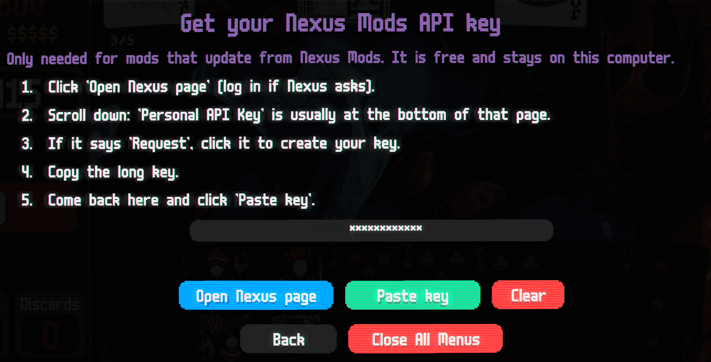

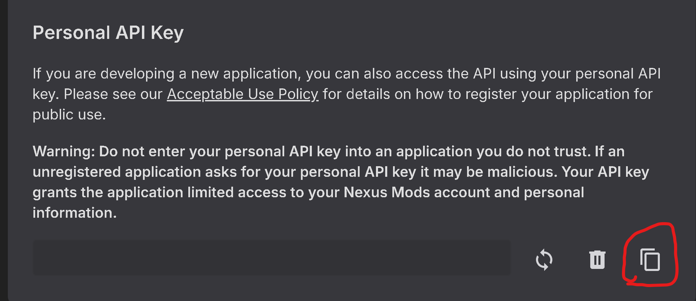

### Git
- Leftover merge conflict markers (`<<<<<<<`) are repaired automatically.
- If your local edits clash with an update, the update still goes in and your edits are saved in `git stash list`.
- `git_reset_on_diverge: true` in `autoupdater_config.json` resets mods whose author rewrote history (a backup is made first).

### Steamodded and Lovely
- Steamodded is checked by reading its `version.lua`. Lovely is checked by comparing its file in the game folder (`winmm.dll` since Lovely 0.10.0, `version.dll` before) with the latest release.
- Updates are staged and applied by `apply_pending.ps1` after Balatro closes. Click **Restart now** to apply them.
- Applying never replaces Steamodded with the same or an older version, and old staged updates are removed once you are current.

## In-game tabs

| Tab | What it does |
|---|---|
| **Mod Toggles** | Turn update checks on or off per mod, **All on / All off**, **Save list / Restore list**, per-mod **Check** button, sort (A-Z / Recent) and **Show** filter (All / ON / OFF). |
| **Backups** | Version in use and last update for each mod, restore or pin a backup, **delete** backups (one at a time or several ticked at once), **Unpin**, sort and **Show** filter (All / Pinned). Hover a row for a summary of the newest changes. |
| **Fork Finder** | Forks with newer work, **Switch to Fork / Switch Back**, **Scan Now**, GitHub token setup. |
| **No Source** | Mods with no git clone or `update.json`. Paste their GitHub or Nexus link to create one. |
| **Config** | Nexus key, GitHub token, auto-check, pin retry, game backup options. |

Every screen has a red **Close All Menus** button (**hold B** on a controller or press **Esc**). Controller: **LT / RT** switch tabs, **LB / RB** turn pages (hold to jump to the first or last page), **R3** jumps to search (hold to clear).

### Mod Toggles
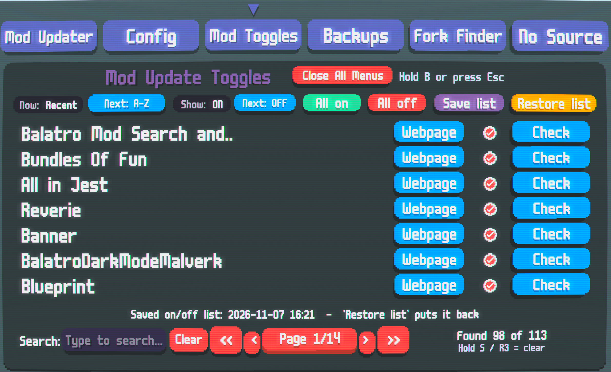

### Backups
Each row shows the version in use and when it was last updated. **Backups** opens the saved copies of that mod, **Restore & Pin** puts one back and stops updates for it until you press **Unpin**.

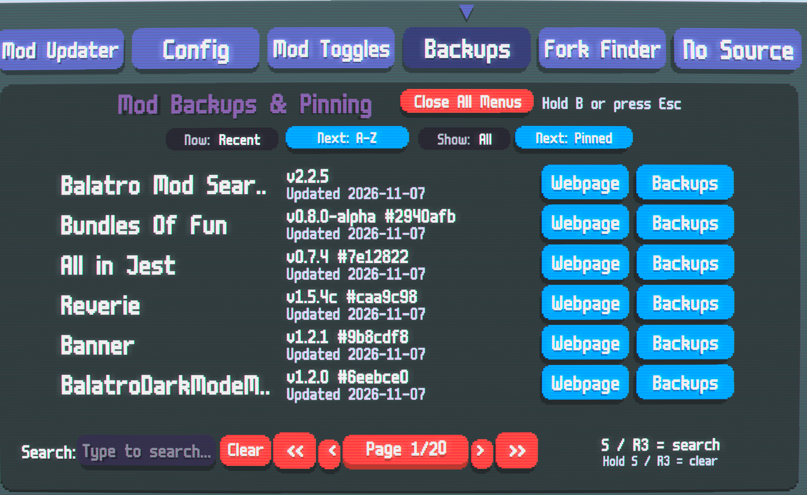

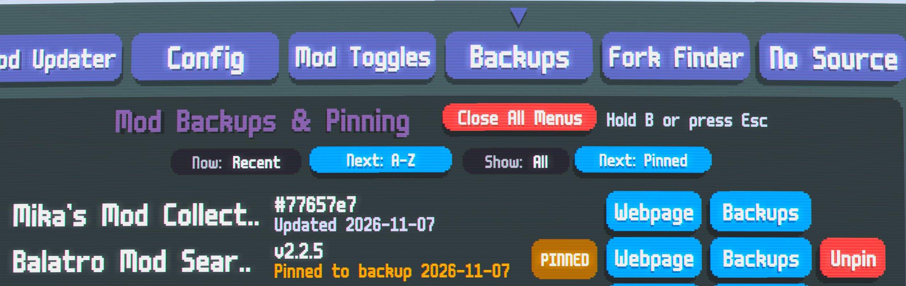

**Deleting old backups.** Each backup in a mod's list has a red **Delete** button and a tick box. Press **Delete** to remove that one, or tick several and press **Delete Selected (n)** above them. Either way you are asked to confirm first:

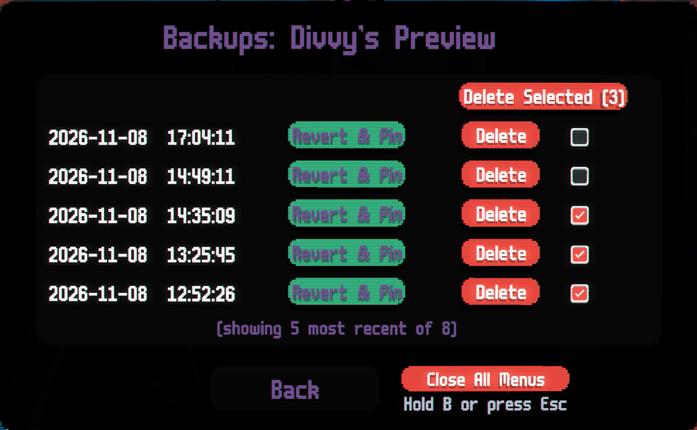

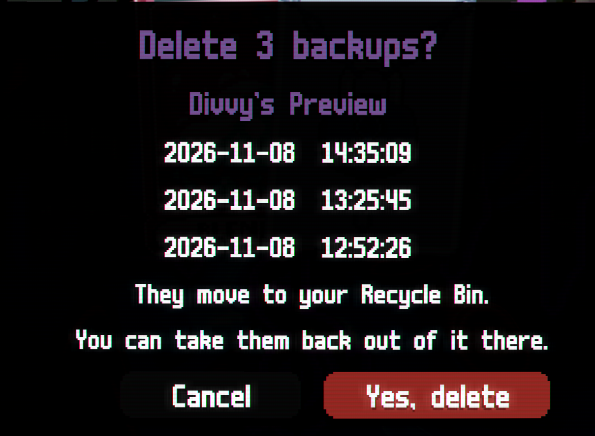

Deleted backups go to the **Windows Recycle Bin**, so you can take them back out of it there. Nothing is deleted for good. A small script, `delete_backups.ps1`, does the moving, and it only touches `.zip` and `.dll` files inside the Updater's backup folders. Afterwards the list opens again with the remaining backups, or the Backups tab if none are left. This works with the mouse, keyboard and controller. A mod pinned at a backup you delete stays pinned (you just cannot go back to that copy). The saved Balatro game copies have no Delete button.

### No Source
Paste the mod's GitHub or Nexus page link and the Updater writes its `update.json` for you.

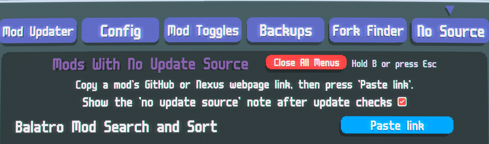

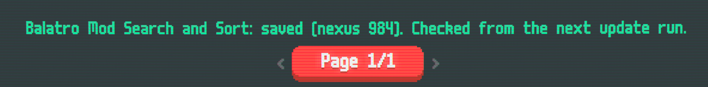

### Config
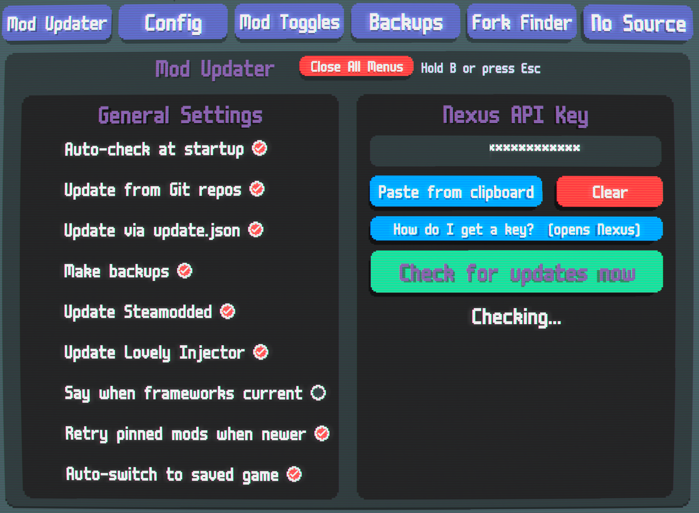

## Fork Finder and the GitHub token

Fork Finder lists forks of your mods with newer work (**Show newer forks only**, the default) or every recently active fork (**Show all forks**). **Scan Now** scans for whichever is selected. A scan only looks for forks: it never updates or changes a mod.

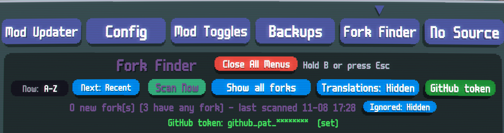

While a scan runs, the status line and **NEWER SCAN IN PROGRESS** ride a wave, and the last result stays on screen with its date until the new one is in. With a GitHub token a repeat scan usually takes well under a minute.

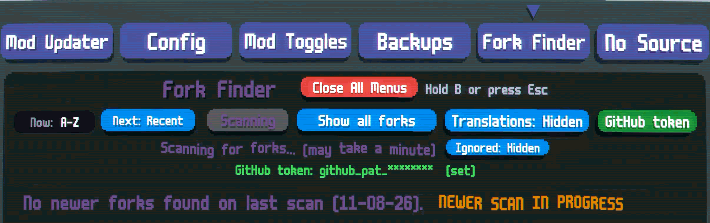

Hover a mod in the list to see which copy is the most recently updated one. **View Forks** lists every fork of that mod: hover a fork for what it changed, how many commits it has that you don't (and the other way round), and press **Switch to Fork**. **Switch Back** returns to the copy you had. Tick **Ignore scans** on forks you never want to see again.

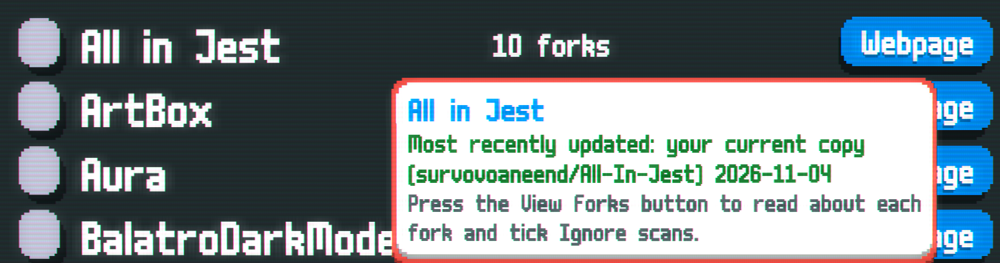

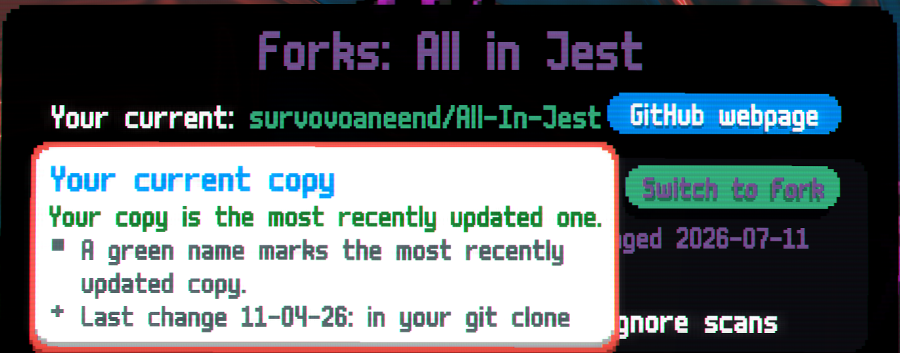

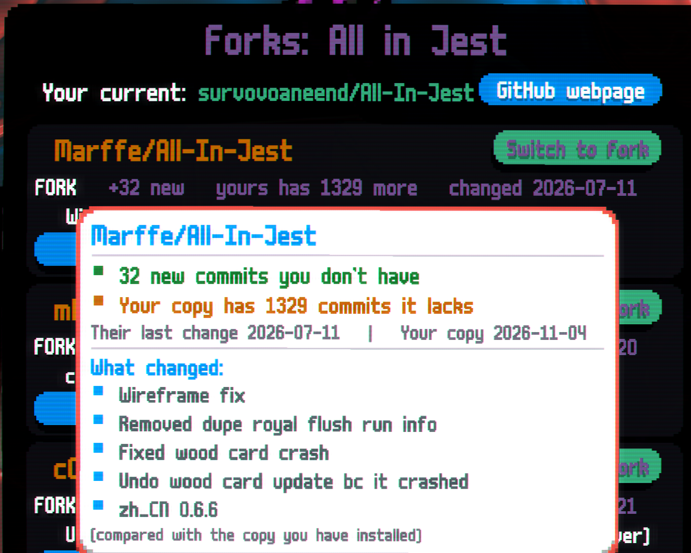

GitHub only allows 60 requests per hour without a token, so a scan of a big mod list stops early. **Fix it once, in about a minute:**

1. Open **Fork Finder**, click **GitHub token**, then **Open GitHub page** (log in if GitHub asks).
2. The token name and **Expiration: 90 days** are already filled in. Set **Repository access** to **Public repositories (read-only)** and leave every permission untouched.
3. Click **Generate token** and copy it (starts with `github_pat_`).
4. Back in the game click **Paste token**, then **Scan Now**.

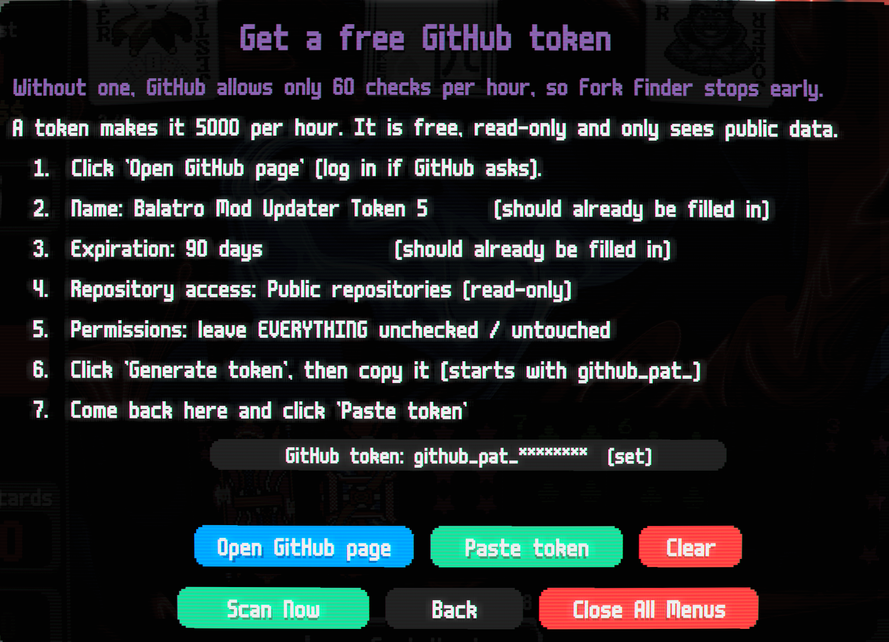

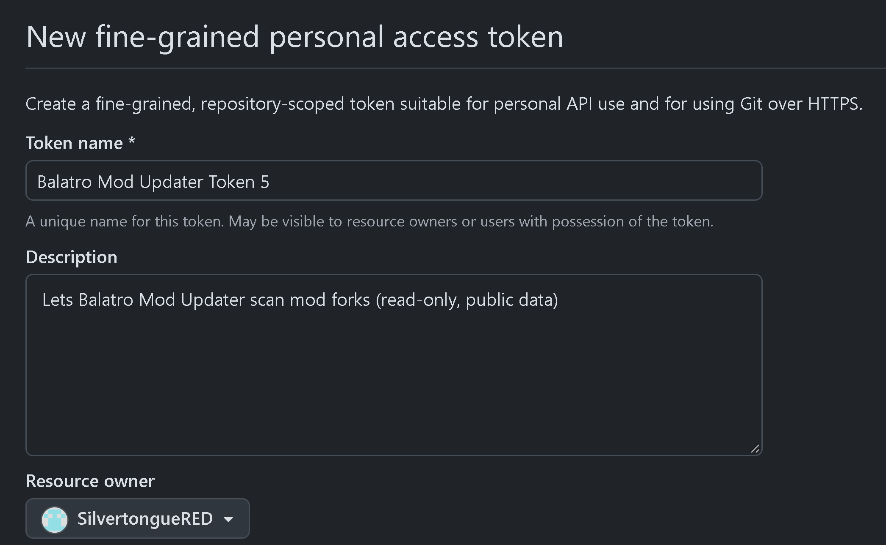

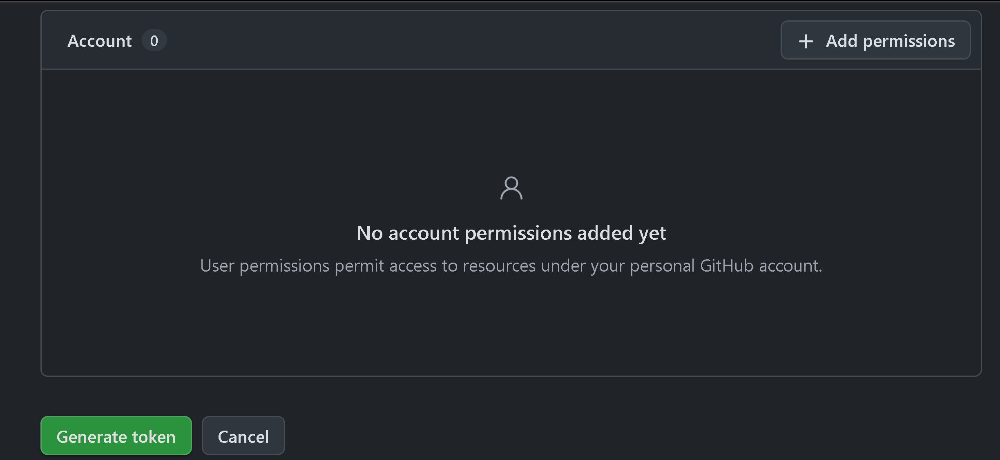

The token only reads public data. When it expires the next scan offers **Yes, replace it**.

## Saved copies of the game

- The first check saves a copy of the Balatro game files in `AMU_GameBackups`, next to your `Mods` folder. Every new Steam build is saved too, and the newest 3 copies are kept (`game_backup_keep`).
- When Steam updates the game, the Updater saves the new version, stages a switch back to the saved copy you were on, and **freezes mod and Steamodded/Lovely updates**, because a mod built for the new game could crash the old one.
- Updates stay frozen until you turn them on: **Mods > Mod Updater > Backups > Balatro game files > Use Steam's newest game + turn updates on**.
- **Allow mod updates on a saved copy** (same window) lets mods update on an older game. Only use it if you know what you are doing.
- `Use backed up game.bat` does the same from outside the game: pick a saved copy by number, or **S** for Steam's version. Close Balatro first.
- Turn the feature off with `"game_backup": false`, or only the automatic switch with **Auto-switch to saved game** in Config.

## If the game won't start after an update

1. **Crash before the main menu:** a recovery screen lists the mods that were just updated. Choose **Put them all back and restart**, **Choose which mods to put back...**, or **Show the crash report** (changes nothing).

   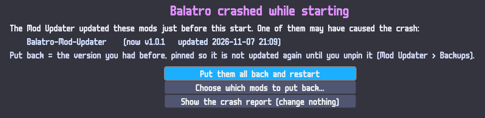

2. **The game reaches the main menu after a failed start:** the **Crash Detected** question appears. Nothing changes until you answer.
3. **Neither screen shows up:** close Balatro and double-click `Undo last update.bat`. Press **Enter** to put everything back, type numbers like `1,3` for only some, or `K` to keep everything.
4. **A Steam update broke your mods:** the Updater switches back to the saved game by itself. By hand, close Balatro and run `Use backed up game.bat`.

Put-back mods are **pinned**: they are not updated again until you unpin them in **Backups**, or until their source has a newer version and **Retry pinned mods when newer** is on.

## Settings (`autoupdater_config.json`)

| Setting | Default | Meaning |
|---|---|---|
| `github_token` | empty | Raises GitHub's limit from 60 to 5000 requests per hour. Easier to set from the **GitHub token** button. |
| `report_untracked` | `true` | `false` stops listing untracked mods. |
| `game_backup` | `true` | Save copies of the game files. |
| `game_backup_keep` | `3` | How many saved game copies to keep. |
| `game_auto_switch` | `true` | Switch back to the saved game after a Steam update. |
| `allow_updates_on_backup_game` | `false` | Let mods update while an older saved game is installed. |
| `pin_retry_newer` | `true` | Release a pin and update when the source has something newer. |

## Known limits and troubleshooting

**Install and environment**
- **Steam still shows Resume after you quit.** The Updater ends its background check within a few seconds of the game closing. If Steam still waits, read `quit_watch.log` in the Updater folder: it records each check and what was stopped at quit.
- **The game window never appears after Restart now.** Read `amu_restart_helper.log` in the Balatro save folder. Since 1.0.1 the helper restarts the game once by itself when Lovely hangs at start-up; if it says `stuck` twice, send that log and the two newest files in `Mods\lovely\log`.
- **Game does not relaunch after Restart now.** Task Scheduler may be blocked by antivirus or a work policy. The Updater falls back to the `steam://` link: start the game from Steam yourself.
- **Updates never run.** Check that Windows PowerShell 5.1 is installed and scripts are allowed to start.
- **Antivirus flags `autoupdate.ps1`.** A script that downloads files can look suspicious. The whole script is readable in this repository.

**Network limits (not a bug in the mod)**
- **GitHub 60 requests per hour without a token.** Fork scans fail first. Use the **GitHub token** button.
- **Nexus key rejected or rate limited.** Paste the key again, or wait an hour. Error 401 means the key was rejected.
- **Download cut off mid-update.** Can leave a half-extracted mod. Restore the newest backup from **Backups**.

**Steamodded and Lovely**
- **Update staged, not applied.** Click **Restart now**. If you just quit, it is applied when the game closes.
- **Restoring by hand.** Backups are zips in `_framework_backups`, plus `winmm.dll.bak_<date>` files next to Lovely.

**Folder names with a version in them**
- Updates change the files, not the folder name. Rename the folder by hand with the game closed. This resets that mod's toggle and pin, because they are saved by folder name.

**Conflicts with other mods**
- **Mods that replace `love.wheelmoved`** (Better Mouse and Gamepad is one): if wheel scrolling fails, check your other mods.
- **Controller mods that use R3 or S:** the search key may do nothing. Click the search box with the mouse.
- **Old copies of a mod inside `Mods`:** two mods with the same ID crash the game. Move backups and `.bak` copies out of `Mods`.

## Changelog

### 1.0.28
- New: delete backups from a mod's **Backups** window. Every backup has a red **Delete** button and a tick box, and **Delete Selected (n)** above them deletes all the ticked ones. Both ask to confirm first, send the files to the Windows Recycle Bin (never a permanent delete) and then show the list again, or the Backups tab when no backup is left. Works with controller too. Covers mod backups and the Steamodded / Lovely copies, not the saved game copies.
- New: `delete_backups.ps1`, a small script that does the moving. It only touches `.zip` and `.dll` files directly inside the backup folder it is given, and it leaves a file where it is when the Recycle Bin refuses it.

### 1.0.27
- Fixed: Steam still showed the game as running after you quit during an update check or fork scan. Waiting on the internet (downloads, GitHub calls, git fetch) is now cut at once when the game closes, a step that writes files gets at most 20 seconds, and any git process the check started is ended with it. A git lock left by a cut-short fetch is cleared at the next check. `quit_watch.log` in the Updater folder records each quit.
- Fixed (since 1.0.26): the background check kept running after it was done, so the game only noticed through its 5 minute timeout, and **Unpin** stayed on "Checking for a newer version..." for good. The check now ends itself as soon as it is done, and the Unpin check also stops waiting after the usual timeout and reads the result.
- Faster: **Scan Now** only scans forks. It no longer runs the whole mod update first (mods are still updated at every launch and by **Check for updates now**) and reads your mods exactly as installed.
- Faster: with a GitHub token, the fork scan checks the GitHub answers it used last time up to 8 at once. Every answer is still checked with GitHub during the scan, so results are as fresh as before. A repeat scan went from minutes to about 14 seconds on a list of about 60 mods.
- Faster: the update check fetches up to 6 git mods at once. A fetch that fails that way is run again the normal way.
- Faster: backups and unzipping use .NET directly instead of Compress-Archive / Expand-Archive. The Updater's own backup leaves out its GitHub cache and saved Steamodded / Lovely copies (a restore keeps the current ones anyway). One self-update had taken over 13 minutes because of this.
- Changed: with nothing to list, Fork Finder says "No newer forks found on last scan (MM-DD-YY)." While a scan runs it adds **NEWER SCAN IN PROGRESS**, and that and the "Scanning for forks..." line ride the same wave as "Shuffling mods...". Other messages on that line stay still.
- Changed: the **Open fork page / Release** button in View Forks is a little wider and its text uses the biggest size that still fits.

### 1.0.26
- Fixed: Steam kept showing the game as running after you quit during an update check or fork scan. The 1.0.22 fix only looked between steps, so one slow step still held Steam. A second thread in autoupdate.ps1 now ends the script as soon as Balatro exits. A step that writes files (installing a mod, a framework update, saving a JSON file or a GitHub answer) always finishes first, so nothing is left half written.

<details>
<summary>Older versions (33)</summary>

### 1.0.25
- Changed: in the "Your current" hover the Last change line uses a small star icon instead of a square bullet and reads like "Last change 08-13-25: on GitHub" (month-day-year).

### 1.0.24
- Changed: the Fork Finder list hover says "Press the View Forks button to read about each fork and tick Ignore scans." so it matches the button name.

### 1.0.23
- Changed: the hover on "Your current" in View forks is a bulleted list. The scan now checks the real commits of your git clone, so "Your downloaded copy does NOT have it yet" (red, blinking) only shows when your copy is really missing GitHub's newest commit, and nothing shows when it has it. If the scan cannot tell (not a git clone, or an old scan), the line is left out. Run Scan Now once to fill this in.

### 1.0.22
- Fixed: Steam kept showing Balatro as running (the "Resume" button) for 1 to 2 minutes after you quit. The update check and the fork scan are started from inside the game, so Steam waited for them. They now stop as soon as Balatro closes: a mod that is already being installed finishes first, the rest is checked at the next launch, and a half-finished fork scan keeps the previous results.

### 1.0.21
- Changed: the hover on "Your current" in View forks reads in a clearer order: the most recently updated line first, then the green name note, then "Last change <date>: newest commit on GitHub (your downloaded copy may not have it yet)". Colours are unchanged.

### 1.0.20
- Changed: in the fork hover, the dates line says "Their last change <date>" (the fork you are hovering) next to "Your copy <date>".

### 1.0.19
- Changed: the Fork Finder top line is clearer. The newer-forks list reads like "0 new fork(s) (3 have any fork) - last scanned 11-08 14:32" and the all-forks list reads like "35 any fork(s) - last scanned 11-08 14:32".

### 1.0.18
- Changed: the hover for a fork in the "View forks" screen is easier to read. Each change has a real bullet square (the game font cannot draw a bullet character, so the old one never showed), wrapped lines are indented under their bullet, "new commits you don't have" is green, "your copy has N commits it lacks" is orange, the two dates share one small grey line, a "What changed:" heading and thin divider lines split the sections, and the "Your copy" bracket note is gone.

### 1.0.17
- Changed: the Fork Finder list hover is shorter. The "Found: ..." and "Your copy: ..." lines are gone. It shows the green "Most recently updated: ..." line (when it is your copy it now names it, like "your current copy (Owner/Name)"), the blue "Using now" line, and the hint.

### 1.0.16
- Changed: the Fork Finder top line is shorter so the scan date fits. It no longer starts with "Showing newer forks only:" or "Showing every fork:" (the filter button already says that). It reads like "2 mod(s) (3 have any fork) - scanned 11-08 13:15".
- Changed: with Translations: Hidden, a fork whose name has a language word (espanol, ESP, translation, and similar) is hidden unless it changes more than 6 non-language files. Forks without a language word in the name are hidden only when nearly all their changed files are language files.

### 1.0.15
- Fixed: the game could crash at start with "Duplicate installation of Steamodded detected ... Possible location: Balatro-Mod-Updater/_gh_cache". Steamodded reads every .json file inside a mod folder as a mod, and the Updater's GitHub answer cache used .json files, some about repos with "Steamodded" in their name. The cache now uses .ghc files, and old .json cache files are renamed automatically.

### 1.0.14
- Changed: one rule everywhere in the Fork Finder. When your copy is not the most recently updated one, the hover shows the most recently updated copy in green and "Using now: <your copy>" in blue. This now also applies to mods you have not switched (before, only switched mods showed "Using now"), and to the "Your current copy" row hover in View Forks.

### 1.0.13
- Fixed: the "last scan" note at the top of the Fork Finder was cut off. It now reads "scanned 11-08 12:10" and fits.
- Changed: the "[N translation(s) hidden]" count is gone from the top line.
- Changed: a switch that is waiting for a restart now stays on the top line ("Restart to apply: <mods>") instead of being replaced by the next refresh.
- Changed: a fork counts as "just a translation" only when nearly all of its changed files are language files. A fork that also changes real code or assets stays listed even with Translations: Hidden, whatever its name says.

### 1.0.12
- Fixed: the Fork Finder gave no sign that a scan was still running after a fork switch (the button just looked greyed out). The button now reads "Scanning" while a scan runs and "Scan Now" when it is done.

### 1.0.11
- Fixed: after a fork switch (Restart later), Scan Now could stay greyed out and do nothing in either filter. The scan result was only watched by one game event that could get lost; a second per-frame watcher now ends the scan, so the button always comes back.

### 1.0.10
- Changed: the Fork Finder keeps the last every-fork scan across game restarts and across newer-only scans, and the status line now shows when the list was last scanned (date and time, and whether it was a newer-only or every-fork scan). The list is filled the moment you open the tab, no rescan needed.

### 1.0.9
- Fixed: updating a git mod failed with "untracked working tree files would be overwritten" when you had a loose file (like release-notes/v5.0.1.md) that upstream then committed. The Updater now stashes just those files (recoverable in git stash list), retries the pull, and notes it.

### 1.0.8
- Changed: the bottom-right pop-ups are wider again (the left gap to the deck is about half as big), so the text wraps less.

### 1.0.7
- Fixed: Switch Back to the copy you had installed before (for example your fork, after trying the parent) did not show "Using now: <repo>" and "(restart to apply)" in the Fork Finder hover. The copy you left is now remembered and used as the target of Switch Back.

### 1.0.6
- Fixed: after switching a mod to an OLDER copy (for example back to the parent while a newer fork was installed), the Fork Finder no longer calls the copy you just switched to the "most recently updated" one. The copy you left is still counted, the hover names it as the most recently updated, and the row label ("Parent") is only green when the copy you run now really is the newest.

### 1.0.5
- Changed: the bottom-right pop-ups use the whole width between the deck and the screen edge (the deck's visible card edge is used, not its wider card area), so the text wraps much less.
- Changed: Fork Finder hover names the original or parent as Owner/Name ("Found: parent (owner/mod)"), and the "newest commit on GitHub" note no longer says your clone is older in a way that sounds like a problem.
- Changed: "Your copy is the most recently updated one." is green in the hover.
- Fixed: the Fork Finder row no longer cuts off "changed <date>" or "Release: <tag>"; gaps are tightened and the text is made a little smaller before anything is cut.

### 1.0.4
- Fixed: after **Switch Back** (to the original) the Fork Finder now knows you are on the original, like it does for a fork: the hover shows "Using now" with "(restart to apply)", your copy takes the original's date, and the original card says **Restart to apply**.
- Fixed: after switching to a fork or back, the Fork Finder is rebuilt the same way the filter buttons rebuild it, so you no longer have to click the filter to see the right hover and list.
- Fixed: during a run, the bottom-right pop-ups (**All mods up to date!**, **N new forks found**) now sit in the empty strip to the right of the deck, in the bottom right corner of the screen, and their text wraps to fit it. They no longer cover the deck or its counts. Outside a run they stay in the bottom right corner.
- Fixed: the hover box on a Fork Finder row cut off "(restart to apply)" after you switched fork. It now has its own line.
- Fixed: during a run, the list on the **Mod Toggles**, **Backups**, **Fork Finder** and **No Source** tabs could stay blank (the pager and counts were there, the rows were not) until a page was changed. The list now fills itself on the first frame instead of waiting in the game's busy event queue.

### 1.0.3
- Fixed: during a run, the bottom-right pop-ups (**All mods up to date!**, **N new forks found**) sat on top of the deck. They now sit above the deck and its counts. Outside a run they stay in the bottom right corner.

### 1.0.2
- Fixed: on the **Backups** tab, a pinned row no longer lets "Pinned to backup <date>" run behind the **PINNED** badge, and the **Unpin** button stays inside the panel. The row is laid out to fit the panel width.
- Fixed: after a fork switch, **Fork Finder** knows which fork you are on. Right after pressing **Switch to Fork** the fork card shows **Restart to apply**; after the restart it shows **Active**, the fork leaves the list of newer forks (it is still in the all-forks view), and the other forks are compared with the fork you use now, without a new scan.
- Fixed: the bottom-right pop-ups (**All mods up to date!**, **N new forks found**) were cut off at the right edge in some window sizes, for example borderless. They are now placed inside the game area, which the game fits to any window, monitor or resolution.
- Fixed: after a fork scan, the Fork Finder list could keep showing the old result until you pressed the filter button (twice, to get back to your chosen filter). The list is now rebuilt when the scan ends and once more a moment later.
- Fixed: the Updater's backup of its own folder could fail with "Could not find file ...update_timing.log", because the game rewrites that log while the backup is being zipped. If zipping fails, the backup is now made from a copy and files that disappear are skipped.

### 1.0.1
- Fixed: after **Restart now** the game could hang inside Lovely at start-up (its log stopped before "Initialization complete" and no mod had loaded). The restart helper now waits up to 10 seconds (was 3) for the game to close by itself, waits 5 seconds (was 2) before starting it again, and then checks the new Lovely log. If Lovely has not finished starting 45 seconds after its log was created, the helper closes the game and starts it once more. It never closes a game it cannot judge.
- New: `amu_restart_helper.log` (in the Balatro save folder) ends with `Lovely start check: ok` after a normal restart, or lists the recovery steps.

### 1.0.0
First 1.0 release: the 0.8.x series polished and bug-fixed.
- New: bottom-right pop-up when a check or scan ends (**All mods up to date!**, **N new forks found**). Click it to open Fork Finder.
- New: saved copies of the game, with automatic switch back and an update freeze after a Steam update.
- New: pinned mods are retried when their source has something newer (**Retry pinned mods when newer**).
- New: Fork Finder can **ignore a whole mod** (square on each row) and **ignore single forks** (**Ignore scans**), with an **Ignored: Hidden/Shown** button.
- New: **Show** filters on Mod Toggles (All / ON / OFF) and Backups (All / Pinned).
- New: **<<** and **>>** buttons on every list. Controller: hold LB / RB for first / last page.
- New: restart window after Restore & Pin, switching to a fork and switching back.
- New: Unpin checks that mod for a newer version at once.
- New: green / red names on Backups (newest version vs a saved older copy in use).
- New test files: `Test pins and latest.bat`, `Test game backup.bat`, `Test fork ignore.bat`, `Test startup crash.bat`.
- Changed: the fork scan follows the Fork Finder filter and remembers its mode (`scan_mode`). Show all forks uses more GitHub requests, so use a token.
- Changed: switching to a fork or back is faster, and `update_timing_history.txt` logs the time of each step.
- Changed: Checking... and Shuffling mods... start and stop together. Sort, filters and pins are saved immediately.
- Changed: the restart helper runs hidden (no PowerShell window).
- Fixed: Fork Finder stuck on "Scanning for forks...".
- Fixed: "No common ancestor" is skipped quietly instead of shown as a 404 error.
- Fixed: picking a mod's original repo in Fork Finder now does **Switch Back**.
- Fixed: a pin made right before **Restart now** could be lost.

### 0.8.4
- Fixed: holding **S** clears the search even while typing (Mod Toggles, Backups, Fork Finder).
- Fixed: leaving the search box with a controller no longer shifts the tab sideways.
- Fixed: a leftover on-screen keyboard no longer freezes keyboard and controller.

### 0.8.3
- New: bigger Config page (two panels, larger controls).
- New: **How do I get a key?** button for the Nexus key, and **Paste key**.
- New: clearer Nexus 401 error on the results screen.
- Changed: red **Close All Menus** button now sits on the title line with its hint.
- Changed: bigger page selector and No Source tab, new mod description cards.
- Fixed: Up / Down on the Config buttons no longer jumps to a toggle on the left.

### 0.8.2
- New: search on Mod Toggles, Backups and Fork Finder (keyboard **S**, controller **R3**, hold to clear).
- New: Fork Finder sort (**A-Z** / **Recent**).
- New: crash recovery screen for crashes before the main menu.
- Changed: bigger, roomier Mod Toggles, Backups and Fork Finder tabs.
- Fixed: Crash Detected question waits for the main menu, and re-asks after **Not now**.

### 0.8.1
- New: a startup crash now asks what to do (**put them all back**, **Choose mods...**, **Not now**) instead of changing things by itself.
- New: `Undo last update.bat` lets you choose which mods to put back.
- Fixed: pins made by `Undo last update.bat` were lost on the next start.
- Works with **Auto-check at startup** off.

### 0.8.0
- New: Fork Finder finds the whole family (Original, Parent, Parent fork, Fork-fork), newest first and clearly labelled.
- New: **Translations: Hidden / Shown** button.
- New: **Page** and **Open GitHub / Nexus page** buttons for your current copy.
- New: Lovely requirement fixer for forks that ask for a Lovely version that does not exist.
- Changed: switching returns you to the Fork Finder list.

### 0.7.9
- New: **Hold B** (about 0.7 s) closes all menus. A quick tap is Back.
- Fixed: your settings (Nexus key, GitHub token, `config.lua`, lists) survive updates of the updater itself.
- Changed: Mod Toggles and Backups layout cleanups, D-pad / stick moves along a row.

### 0.7.8
- New: **Close All Menus** on every screen, **Save list / Restore list** on Mod Toggles.
- New: Backups hover summary, Fork Finder **Open fork page** button.
- Changed: fixed-size lists so nothing overlaps or jumps.
- Fixed: crash on the "Check for updates now" result screen.

</details>

---

<!-- other-mods:start -->
## More from SilvertongueRED

**Mod Updater is on Nexus Mods:** [nexusmods.com/balatro/mods/1002](https://www.nexusmods.com/balatro/mods/1002).

**Fit to Screen (Menu Resizer) is now on Nexus Mods:** [nexusmods.com/balatro/mods/1001](https://www.nexusmods.com/balatro/mods/1001). It stops tall pause menus and sidebars from being cut off at the top and bottom of your screen.

### See my other mods and forks of other people's mods

- [Balatro-Fit-To-Screen-Menu-Resizer-](https://github.com/SilvertongueRED/Balatro-Fit-To-Screen-Menu-Resizer-) ([Nexus Mods](https://www.nexusmods.com/balatro/mods/1001)) - stops tall pause menus and sidebars from being cut off at the top and bottom of your screen
- [Balatro-Mod-Search-and-Sort](https://github.com/SilvertongueRED/Balatro-Mod-Search-and-Sort) ([Nexus Mods](https://www.nexusmods.com/balatro/mods/984)) - search, filter and sort the Mods menu without messing up the load order
- [Balatro-SaveRewinder-Config-Fix](https://github.com/SilvertongueRED/Balatro-SaveRewinder-Config-Fix) - Save Rewinder fork with a config fix: automatic save points and one key to rewind (a fork of [liafonx/Balatro-SaveRewinder](https://github.com/liafonx/Balatro-SaveRewinder))
- [Trance-Active-and-Updated](https://github.com/SilvertongueRED/Trance-Active-and-Updated) - colour and font manager that recolours the whole game, maintained fork (a fork of [SpectralPack/Trance](https://github.com/SpectralPack/Trance))
- [Balatro-Preview-Accuracy-Update](https://github.com/SilvertongueRED/Balatro-Preview-Accuracy-Update) - previews the score and dollars you will get from the selected cards, accuracy update (a fork of [DivvyCr/Balatro-Preview](https://github.com/DivvyCr/Balatro-Preview))
- [BalatroMods-HoldForFinalHandScore-Update](https://github.com/SilvertongueRED/BalatroMods-HoldForFinalHandScore-Update) - holds the final hand score on screen long enough to read it (a fork of [pumpncode/BalatroMods](https://github.com/pumpncode/BalatroMods), original mod by [Wiwiweb/BalatroMods](https://github.com/Wiwiweb/BalatroMods))
- [Main-Menu-Theme-Selector](https://github.com/SilvertongueRED/Main-Menu-Theme-Selector) - choose your main menu colours, background theme and title logo (a fork of [EmperorGesar/Balatro-Colour-Selector](https://github.com/EmperorGesar/Balatro-Colour-Selector))
- [Better Mouse and Gamepad (bmag)](https://github.com/SilvertongueRED/bmag) - bind any key or button to quick actions like multiselect, easier on your hands (a fork of [uptudev/bmag](https://github.com/uptudev/bmag))
- [Balatro-Music-Selector-Fixes-and-Features](https://github.com/SilvertongueRED/Balatro-Music-Selector-Fixes-and-Features) - pick extra soundtracks or your own music without installing all of Cardsauce (a fork of [DZAladan/Balatro-Music-Selector](https://github.com/DZAladan/Balatro-Music-Selector))
<!-- other-mods:end -->
